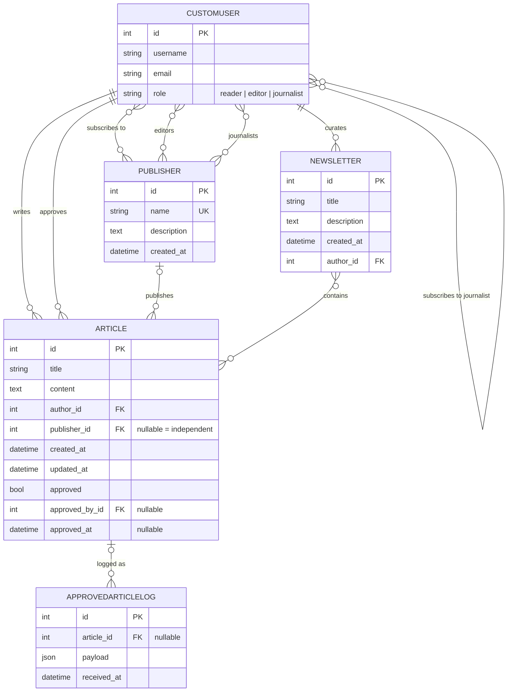
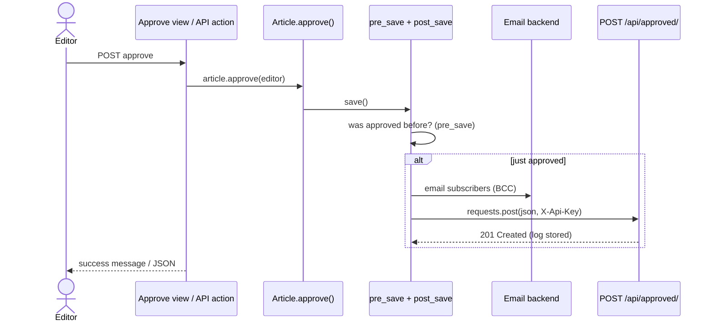

# Planning and design: The Daily Ledger

This document records the design work done before implementation:
requirements, the database design and its normalisation, the role
model, and the front-end plan.

---

## 1. Functional requirements

What the system must do.

### Accounts and roles
- FR1. Visitors can register as a **Reader**, **Journalist** or
  **Editor** from the sign-up page.
- FR2. Users can log in and log out of the website.
- FR3. Every user has exactly one role and is automatically placed in
  the group of the same name (Reader, Editor, Journalist).
- FR4. Each group has these permissions:
  | Group      | Articles                     | Newsletters                  |
  |------------|------------------------------|------------------------------|
  | Reader     | view                         | view                         |
  | Editor     | view, change, delete, approve| view, change, delete         |
  | Journalist | add, view, change, delete    | add, view, change, delete    |
- FR5. Readers hold subscriptions to publishers and journalists.
  Journalists/editors have no subscriptions (their values are `None`).
- FR6. Journalists have articles and newsletters (reverse relations).
  Readers' values for these are `None`.

### Articles
- FR7. Journalists write articles, either independently or for a
  publisher they belong to.
- FR8. New articles are unapproved and hidden from readers.
- FR9. Editors see a review queue and approve articles.
- FR10. When an article is approved:
  - it is emailed to every reader subscribed to its journalist or
    its publisher (each reader once), and
  - it is POSTed to the project's own `/api/approved/` endpoint,
    which stores a log record.
- FR11. Journalists edit/delete only their own articles; editors can
  edit/delete any article.

### Newsletters
- FR12. Journalists create newsletters: a title, description and a
  selection of approved articles.
- FR13. All roles can view newsletters; journalists (own) and editors
  (any) can edit or delete them.

### Publishers and subscriptions
- FR14. Anyone can browse publishers and journalist profiles.
- FR15. Readers subscribe/unsubscribe to publishers and journalists,
  and see a personal feed of their subscribed content.
- FR15a. Editors create publishers and assign their editors and
  journalists from the website (`/publishers/new/`).

### REST API
- FR16. Token authentication via `POST /api/token/`.
- FR17. `GET /api/articles/` lists approved articles.
- FR18. `GET /api/articles/subscribed/` lists approved articles from
  the reader's subscriptions.
- FR19. `GET/PUT/PATCH/DELETE /api/articles/<id>/` and
  `POST /api/articles/` with role-based protection.
- FR20. `POST /api/articles/<id>/approve/` for editors only.
- FR21. Serializers for Article, User, Newsletter and Publisher.

---

## 2. Non-functional requirements

Qualities and constraints of the system as a whole.

- **Security**
  - Passwords hashed by Django; CSRF protection on all forms.
  - Token authentication for the API; every API endpoint requires a
    logged-in user, except `/api/token/`.
  - Access control enforced on the server for every action (views and
    API), never only by hiding buttons.
  - `/api/approved/` accepts writes only with a shared secret header
    (`X-Api-Key`), compared in constant time.
  - Secrets and database credentials live in `.env`, not in code.
  - Reader email addresses are sent as BCC, never visible to others.
- **Reliability**: an email or HTTP failure during approval is logged
  but never undoes the editor's approval.
- **Data integrity**: database in 3NF; model validation stops readers
  authoring articles and journalists posting to publishers they don't
  belong to; subscriptions are guarded at the database-relation level
  (`m2m_changed`).
- **Database**: MariaDB in production (utf8mb4, strict mode).
- **Maintainability**: PEP 8 (checked with flake8), small focused
  functions and modules (`roles`, `services`, `signals`,
  `permissions`), docstrings and comments.
- **Testability**: 95 automated tests run with Django's test runner;
  external effects (email, HTTP) are mocked.
- **Usability**: responsive layout from 360 px phones up; clear role
  badge and role-specific navigation; feedback messages after every
  action; friendly 403 page.
- **Performance**: `select_related`/`prefetch_related` on list pages,
  pagination (10 per page).

---

## 3. Database design

### Entity relationship diagram

The many-to-many relations are stored in join tables:

| Join table                               | Columns                         |
|------------------------------------------|---------------------------------|
| `news_customuser_subscribed_publishers`  | customuser_id, publisher_id     |
| `news_customuser_subscribed_journalists` | from_customuser_id, to_customuser_id |
| `news_publisher_editors`                 | publisher_id, customuser_id     |
| `news_publisher_journalists`             | publisher_id, customuser_id     |
| `news_newsletter_articles`               | newsletter_id, article_id       |

### Normalisation

- **1NF**: every column holds one atomic value. Lists (subscriptions,
  a publisher's staff, a newsletter's articles) are rows in join
  tables, not comma-separated columns.
- **2NF**: every table has a single-column surrogate primary key
  (`id`), so no attribute can depend on part of a key.
- **3NF**: no non-key column depends on another non-key column.
  For example, an article stores `publisher_id`, not the publisher's
  name; the author's name is read from the user table.
- **Deliberate exception**: `ApprovedArticleLog.payload` keeps a JSON
  copy of the article as it was when approved. This is an audit
  snapshot that must not change if the article is later edited or
  deleted, so copying the data is the correct design here.

### Role rules in the model

- `role` decides the group: saving a user calls
  `roles.assign_role_group()`, which moves them into the matching group.
- Reader-only fields (`subscribed_publishers`,
  `subscribed_journalists`) are cleared when a user is saved with any
  other role, and an `m2m_changed` handler refuses to add them for
  non-readers. The properties `publisher_subscriptions` and
  `journalist_subscriptions` return `None` for non-readers.
- Journalist data (`articles`, `newsletters`) are reverse relations.
  The properties `independent_articles` and `independent_newsletters`
  return `None` for non-journalists.
- A ManyToManyField can't literally store `None` in the database, so
  "None" is represented by an empty relation plus `None` from the
  accessor properties and in the API's user serializer.

---

## 4. Approval flow (Option 1: Django signals)

Why signals? The approval can happen in three places (website, API,
admin action). Putting the side effects in a `post_save` handler means
all three behave the same way without repeating code, and the handler
only fires on the *transition* to approved, so later edits don't
re-send emails.

---

## 5. Front-end (UI/UX) plan

Visual identity: a newsprint look. Warm paper background, ink-black
serif headings (Fraunces), a clean sans body (Instrument Sans) and a
single red accent for kickers and destructive actions.

| Page | URL | Who | Purpose |
|------|-----|-----|---------|
| Front page | `/` | everyone | latest approved articles, search, publishers |
| Article | `/articles/<id>/` | logged in | full article; edit/delete/approve buttons by role |
| Write / edit | `/articles/new/`, `/articles/<id>/edit/` | journalist | article form, publisher choice limited to own publishers |
| My desk | `/articles/mine/` | journalist | pending vs published articles, newsletters |
| Review queue | `/review/` | editor | pending table with Approve button |
| Newsletters | `/newsletters/` | logged in | newsletter cards |
| Newsletter form | `/newsletters/new/` | journalist | pick approved articles |
| Publishers | `/publishers/`, `/publishers/<id>/` | everyone | staff, articles, subscribe |
| Journalist | `/journalists/<id>/` | everyone | profile, articles, subscribe |
| My subscriptions | `/subscriptions/` | reader | feed + follow/unfollow |
| Log in / Sign up | `/accounts/login/`, `/signup/` | visitors | accounts |

Navigation changes with the role: readers see *My subscriptions*,
journalists *My desk* and *Write*, editors *Review queue*. A role badge
next to the username shows the current role.
